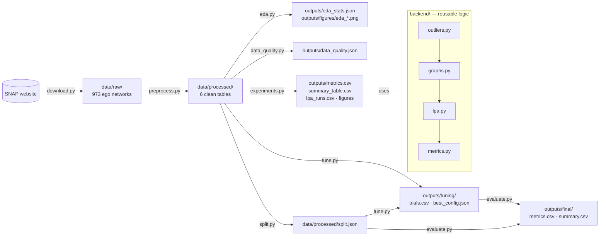

# Code Guide

A guide to every file in this project: what it does, what it reads and writes, and how the parts fit together.
To run the project step by step, see [`EXECUTION_STEPS.md`](EXECUTION_STEPS.md). For the data findings,
see [`report/EDA_REPORT.md`](report/EDA_REPORT.md).

---

## 1. The big picture

The project answers one question: **can Label Propagation group Twitter users into communities that share
interests?** The code is a chain of stages (download, preprocess, data quality, EDA, experiments, split, tune, evaluate). Each stage reads the previous stage's files, so any stage can be
re-run on its own.



| Folder | Role |
|---|---|
| `pipeline/` | **Scripts you run**, one per stage. Each has a `main()` and runs as `python -m pipeline.<name>`. |
| `backend/` | **Reusable logic**: graph building, the LPA algorithm, quality metrics. The pipeline uses it now, and the FastAPI app (step 11) will reuse it. |
| `tests/` | One test file per module, 91 tests in total. Run with `pytest -q`. |
| `notebooks/` | `01_eda.ipynb`, the EDA with explanations. It calls `pipeline/eda.py`. |
| `report/` | Written reports (`EDA_REPORT.md`). |
| `data/` | `raw/` is downloaded (~350 MB, git-ignored); `processed/` is built by preprocessing (~23 MB). |
| `outputs/` | Everything the experiments and EDA produce: CSVs, JSON, PNG figures. |

### Key terms

| Term | Meaning here |
|---|---|
| **Ego / ego network** | One Twitter user (the ego) and the accounts they follow, plus the follow links among those accounts. The dataset has 973 of them. |
| **Circle** | A list the ego made by hand (like a Twitter List). Used as **ground truth** to check communities. |
| **Token** | One interest: a `#hashtag` or an `@mention` that appears in a user's tweets. |
| **Label Propagation (LPA)** | Every user starts with their own label. Users repeatedly adopt the label most common among their neighbours, until nothing changes. Users sharing a label form a community. |
| **Modularity** | How much denser the links are inside communities than chance would predict (higher = better separated). |
| **TF-IDF** | Weights tokens so rare, specific tokens (`#esports`) count more than common ones (`#ff`). |
| **ARI** | Adjusted Rand Index: how similar two partitions are (1 = identical). Used to measure LPA's stability across random seeds. |

---

## 2. Setup files

| File | What it is |
|---|---|
| `requirements.txt` | Python packages: pandas, numpy, networkx, scikit-learn, scipy, matplotlib, pyarrow (parquet files), fastapi and uvicorn (step 11), pytest, jupyter. |
| `pyproject.toml` | Project metadata, plus `pythonpath = ["."]` so `pytest` can import `backend` and `pipeline`. |
| `.gitignore` | Keeps `venv/`, `data/raw/`, caches and `node_modules/` out of git. |
| `pipeline/__init__.py`, `backend/__init__.py` | Empty files that turn the folders into Python packages. This is why scripts run as `python -m pipeline.x`. |
| `venv/` | The virtual environment (`python -m venv venv`). Not committed. |

---

## 3. Pipeline scripts (`pipeline/`)

### 3.1 `download.py` (step 2): get the data

```bash
python -m pipeline.download            # --force to start over, --raw-dir to change folder
```

| | |
|---|---|
| **Reads** | `https://snap.stanford.edu/data/` |
| **Writes** | `data/raw/twitter.tar.gz`, `twitter_combined.txt(.gz)`, `readme-Ego.txt`, and `data/raw/twitter/` (973 × 5 files) |
| **Exit code** | `0` if all checks pass, `1` otherwise |

| Function | What it does |
|---|---|
| `download_file(url, dest)` | Downloads to a `.part` file, then renames it, so an interrupted download never looks complete. Skips files that already exist. |
| `extract_egos(archive, raw_dir)` | Unpacks the archive. Skips any entry that would land outside `data/raw/` (a known tar-file safety issue). |
| `decompress(gz_path)` | Un-gzips `twitter_combined.txt.gz` and keeps the original. |
| `verify(raw_dir)` | Counts egos, egos missing files, empty circle files, and the combined file's lines, unique edges and unique nodes. Ignores stray files such as `.DS_Store`. |
| `check(stats)` | Compares those counts with `EXPECTED` (973 / 0 / 35 / 2,420,766 / 1,768,149 / 81,306). |

### 3.2 `preprocess.py` (step 3): raw files → clean tables

```bash
python -m pipeline.preprocess          # about 25 s
```

| | |
|---|---|
| **Reads** | `data/raw/twitter/<ego>.{featnames,feat,egofeat,edges,circles}` |
| **Writes** | the 6 files in `data/processed/` (table below) |

Each ego network stores its features by **index** (feature 0, 1, 2 …), and the indices mean different things
in different egos. The script turns every index back into its **text** (`#python`), so the same interest
links users across egos.

| Function | What it does |
|---|---|
| `normalize_token(raw)` | Cleans one token: lowercase it → keep only the leading word characters (`@mashable:` → `@mashable`) → reject junk (`#1`, `#...`, `#_`). Returns `None` for junk. |
| `build(twitter_dir)` | Loops over all 973 egos. Reads features (`.feat` + `.egofeat`), adds the implicit **ego → every node** follow edges, reads circles, then merges users that appear in several egos. Returns all tables in memory. |
| `write(tables, out_dir)` | Saves the tables as parquet and `circles.json`. |
| `summarize` / `main` | Prints counts and checks users = 81,306, follows = 1,762,504, egos = 973, egos without circles = 35. |

**Output tables:**

| File | One row per | Columns |
|---|---|---|
| `users.parquet` | user (81,306) | `user_id`, `ego_ids` (egos the user appears in), `n_hashtags`, `n_mentions` |
| `interests.parquet` | (user, token) pair (1,084,064) | `user_id`, `token`, `type` (`hashtag` / `mention`) |
| `follows.parquet` | unique follow (1,762,504) | `src` follows `dst` |
| `follows_by_ego.parquet` | follow inside one ego (2,415,109) | `src`, `dst`, `ego_id` (used to build each ego's graph) |
| `egos.parquet` | ego (973) | `ego_id`, `n_nodes`, `n_edges`, `n_circles`, `has_circles` |
| `circles.json` | — | `{ego_id: {circle_id: [user_ids]}}` |

### 3.3 `eda.py` (step 4): describe the data

```bash
python -m pipeline.eda                 # or open notebooks/01_eda.ipynb
```

| | |
|---|---|
| **Reads** | `data/processed/*`, plus `data/raw/twitter/*.featnames` for the token-cleaning counts |
| **Writes** | `outputs/eda_stats.json` and 5 figures `outputs/figures/eda_*.png` |

| Function | What it measures |
|---|---|
| `reciprocity(follows)` | Share of follows that go both ways (48.3%). |
| `degrees(follows)` | Followers (in-degree) and following (out-degree) per user. |
| `ego_density(egos)` | Edges ÷ possible edges for each ego network. |
| `interest_stats(users, interests)` | Token counts, share of users with hashtags, mentions or none, tokens per user, users per token. |
| `circle_stats(circles, egos)` | Circle sizes, how many members are in several circles, and how much of each ego the circles cover. |
| `token_filter_stats(twitter_dir)` | Distinct tokens: raw → lowercased → cleaned. |
| `dataset_stats(t)` | All of the above in one dictionary. |
| `plot_*` (5 functions) | One figure each: degree distribution, top tokens, interest sparsity, circles, ego density. |

### 3.4 `experiments.py` (step 5): run and compare the algorithms

```bash
python -m pipeline.experiments --egos top20 --runs 10 --seed 42 [--direction mutual] [--out-dir outputs/mutual]
```

| | |
|---|---|
| **Reads** | `data/processed/*` (through `backend.graphs.Dataset`) |
| **Writes** | `outputs/metrics.csv`, `summary_table.csv`, `lpa_runs.csv`, `figures/metric_comparison.png`, `figures/communities_ego_<id>.png` |

**What one run does:**

```
for each selected ego:
    for each mode in (follow, interest, hybrid):
        G = build the graph                               ← backend/graphs.py
        for each algorithm in (lpa, nx_lpa, louvain):
            communities = detect(G)                       ← backend/lpa.py or NetworkX
            score the communities                         ← backend/metrics.py
            → one row in metrics.csv
```

| Function | What it does |
|---|---|
| `parse_args(argv)` | All command-line options (`--egos`, `--mode`, `--direction`, `--tokens`, `--k`, `--min-sim`, `--follow-weight`, `--runs`, `--seed`, …). |
| `_detect(G, algorithm, args)` | Runs one algorithm. Our LPA runs `--runs` times and keeps the best; NetworkX LPA and Louvain run once with the same seed. A graph with no edges returns every user alone. |
| `run(data, args)` | The loop above. Returns the metrics table and the per-run LPA table. |
| `summarize(metrics)` | Averages per (mode, algorithm) → `summary_table.csv`. |
| `score_partition(G, comms, follow_G, circles, tokens, f1_baseline, seconds)` | The metric columns for one partition. Extracted from `run()` with no behaviour change, and shared by `experiments`, `tune` and `evaluate`. |
| `plot_metric_comparison` | Bar charts of circle F1, purity, follow modularity and coverage. |
| `plot_ego_communities` | The largest ego drawn three times (one per mode), with LPA's 3 biggest communities coloured. |

**Output files:**

| File | One row per | Use it for |
|---|---|---|
| `metrics.csv` | ego × mode × algorithm | Detailed results; per-ego analysis |
| `summary_table.csv` | mode × algorithm | The main results table in the report |
| `lpa_runs.csv` | ego × mode × LPA run | LPA stability: modularity, iterations, `ari_vs_best` per seed |

### 3.5 `data_quality.py` (step 6): which users carry signal?

```bash
python -m pipeline.data_quality
```

| | |
|---|---|
| **Reads** | `data/processed/*` |
| **Writes** | `outputs/data_quality.json` |

`bucket_users(data)` puts each of the 81,306 users in one bucket: tokens + follows (67,816), tokens only (2,572),
follows only (8,453), neither (2,465). The "neither" users stay singletons; nothing is imputed.

### 3.6 `split.py` (step 7): train / validation / test egos

```bash
python -m pipeline.split [--seed 42] [--force]
```

| | |
|---|---|
| **Reads** | `data/processed/egos.parquet` |
| **Writes** | `data/processed/split.json` (562 / 188 / 188). Refuses to overwrite without `--force`. |

| Function | What it does |
|---|---|
| `make_split(egos, seed, fractions)` | Seeded 60/20/20 split of the 938 egos with circles, stratified by ego size into `N_STRATA` = 4 size quartiles. The strata are not stored in `split.json` (it holds seed, counts, train, val, test). |
| `save_split` / `load_split` | Write and read `split.json`; loading checks the keys and that the lists do not overlap. |
| `assert_no_test_egos(egos, split)` | Raises `ValueError("test egos must not be used for tuning")` if any ego is a test ego. Used by `tune`. |

### 3.7 `tune.py` (step 9): random search for a hybrid configuration

```bash
python -m pipeline.tune [--n-trials 60] [--sample-size 100] [--top-n 5] [--seed 42]
```

| | |
|---|---|
| **Reads** | `data/processed/*` including `split.json` |
| **Writes** | `outputs/tuning/trials.csv`, `outputs/tuning/best_config.json` |

| Name | What it does |
|---|---|
| `GRID`, `DEFAULT_CONFIG` | The search space and the default config (trial 0). Both have the same 8 keys. |
| `sample_configs(n, seed)` | Trial 0 = default, then distinct random draws from `GRID`. |
| `score_ego` / `score_config` | Score one ego / average over egos (hybrid + LPA, 10 runs, seed 42). Purity uses unfiltered `both` tokens; follow modularity uses the unscaled `direction=any` follow graph. |
| `rank_trials(df)` | Feasible first, then objective rounded to 3 decimals, then `circle_f1`. Feasible = `largest_share` <= `MAX_LARGEST_SHARE` (0.5) and `coverage` >= `MIN_COVERAGE` (0.8). |
| `run_tuning(...)` | Stage 1 on a train sample, top `--top-n` confirmed on all val egos. Refuses test egos. |

### 3.8 `evaluate.py` (step 10): the one-time test run

```bash
python -m pipeline.evaluate [--force]
```

| | |
|---|---|
| **Reads** | `data/processed/*`, `split.json`, `outputs/tuning/best_config.json` |
| **Writes** | `outputs/final/metrics.csv`, `outputs/final/summary.csv` |

`check_guards` raises if the config was tuned on test egos, if the egos are not exactly the test set, or if the
output files exist (`FileExistsError`, unless `--force`). `evaluate` scores the tuned config, the default config
and Louvain on the tuned graph. `runtime_s` is 0.0 here (not measured).

---

### 3.9 `analyze.py` (step 10b): explain the tuned config

```bash
python -m pipeline.analyze --which all     # ablation | sensitivity | test | stability
```

| | |
|---|---|
| **Reads** | `data/processed/*`, `split.json`, `outputs/tuning/best_config.json`, `outputs/final/metrics.csv` |
| **Writes** | `outputs/analysis/` (CSVs and `ablation.png`, `sensitivity.png`) |

`run_ablation` and `run_sensitivity` call `assert_no_test_egos` first, so they only run on validation egos.
`run_test_scores` adds the Omega index and its two chance baselines for the tuned, default and Louvain variants on the
test egos; `paired_bootstrap` resamples egos (not rows) for a 95% interval on each difference; `run_stability` measures
how much single LPA runs with different seeds agree (ARI). `score_variant` is `tune.score_ego` plus Omega and works for
any graph mode. None of these changes a setting.

---

## 4. Backend modules (`backend/`)

### 4.1 `graphs.py`: from tables to graphs

| Name | What it does |
|---|---|
| `Dataset` | Holds the 6 processed tables. `Dataset.load()` reads them; `ego_nodes(ego)`, `ego_edges(ego)`, `ego_circles(ego)` and `user_tokens()` look things up; `tfidf(tokens, outliers)` builds and caches the TF-IDF matrix of all users; `clear_tfidf_cache()` empties that cache (used by tuning to save memory). |
| `select_egos(data, spec)` | `"top20"` = the 20 largest egos **that have circles**; `"all"`; or `"12831,14203"`. |
| `follow_graph(data, ego, direction)` | Undirected graph of follows. `any`: a follows b **or** b follows a. `mutual`: **both**. Self-follows are dropped. Weight 1. |
| `interest_graph(data, ego, k, min_sim, tokens)` | Each user is linked to their `k` most similar users (cosine similarity of TF-IDF vectors), if similarity ≥ `min_sim`. Users without tokens stay unlinked. |
| `hybrid_graph(...)` | Interest graph + follow edges. A follow adds `follow_weight` (0.3) to the edge weight. |
| `build_graph(data, ego, mode, ...)` | Picks one of the three above by name. |

`build_graph`, `follow_graph`, `interest_graph` and `hybrid_graph` take an optional `outliers=` keyword (an `OutlierConfig`, section 4.4). With `outliers=None` the result is identical to before. The TF-IDF cache key is `(tokens, (token_max_share, max_tokens))`; `hub_cap` is not in the key because it does not affect TF-IDF.

**Why TF-IDF is computed over all users:** a token's rarity is judged across the whole dataset, so `#ff`
(8,700 users) is weighted down even inside an ego network where it happens to be rare.

### 4.2 `lpa.py`: our Label Propagation implementation

Following Raghavan, Albert & Kumara (2007):

```
1. every node gets its own label
2. repeat (at most 100 times):
       visit all nodes in a new random order
       each node takes the label with the highest total edge weight among its neighbours
         - tie: pick one at random, but keep the current label if it is among the tied best
   until a full pass changes no label
3. nodes with the same label form a community
```

| Name | What it does |
|---|---|
| `label_propagation(G, seed, max_iter, weight, trace)` | One run. Returns an `LPAResult`. The same `seed` always gives the same result. With `trace=True` it stores the labels after every pass (for the step-through animation in the frontend). |
| `LPAResult` | `labels` (node → label), `communities` (list of sets, largest first), `iterations`, `converged`, `seed`, `modularity`, `trace`. |
| `best_of_runs(G, runs, seed)` | Runs LPA with seeds `seed, seed+1, …` and returns the run with the highest modularity, plus all runs. |

### 4.3 `metrics.py`: how good are the communities?

| Function | Question it answers | Range |
|---|---|---|
| `safe_modularity(G, communities)` | Are links denser inside communities than chance? `NaN` if the graph has no edges. | −0.5 … 1 |
| `community_stats(communities)` | How many communities (size ≥ 2)? How many users left alone? `coverage` = share of users in a community; `largest_share` = size of the biggest community. | — |
| `circle_f1(communities, circles)` | Do communities match the ego's circles? Scores only users who are in a circle; averages "each circle's best community" and "each community's best circle". `NaN` without circles. | 0 … 1 |
| `interest_purity(communities, tokens)` | In each community, what share of members hold its most common token? Weighted by community size. | 0 … 1 |

### 4.4 `outliers.py`: optional outlier rules

All rules are off by default and validated (bad values raise `ValueError`).

| Name | What it does |
|---|---|
| `OutlierConfig(token_max_share, hub_cap, max_tokens)` | The three settings. `None` means off. |
| `filter_tokens(interests, n_users, cfg)` | `token_max_share`: drops tokens used by more than that share of all users. `max_tokens`: keeps each user's rarest N tokens. |
| `hub_factors(G, cap)` | `hub_cap`: a hub's follow-edge weights are scaled by `cap / degree`. If both ends are hubs the factors multiply. In a hybrid edge only the follow part is scaled. |

**Reading the metrics together:** a high circle F1 with `largest_share` ≈ 0.8 means "one giant community",
not success. Always compare with `circle_f1_one_community` (the score of putting everyone in one group).

---

### 4.5 `overlap.py`: overlap-aware comparison with circles

| Name | What it does |
|---|---|
| `omega_index(a, b, nodes)` | Chance-adjusted agreement of two (possibly overlapping) covers: for every pair of users, do they share the same *number* of groups in both? 1 = identical, about 0 = chance. |
| `circle_omega(communities, circles)` | Omega of communities vs circles, scored only on users in at least one circle; NaN without circles (same rule as circle F1). |
| `random_partition_like(communities, rng)` | A random partition with the same community sizes: the chance baseline to read Omega against. |

---

### 4.6 The API: `service.py`, `app.py`, `schemas.py`, `main.py`

| File | Job |
|---|---|
| `service.py` | All the logic, with no FastAPI imports: `run_detection` (build the graph, run LPA, score it, replay the best seed for the trace), `compute_warnings`, the `JobStore` (newest 50 runs, thread-safe), `validate_data_dir`, and one function per payload (`graph_payload`, `communities_payload`, `trace_payload`, `user_payload`, `egos_payload`, `compare_payload`, `stats_payload`). `NotFound` and `DataError` are its two errors. |
| `app.py` | `create_app(data=None, data_dir=None, outputs_dir=None)`: the routes, CORS for `localhost:5173`, and the 404 and 422 handlers. Tests pass a ready `Dataset`. |
| `schemas.py` | The pydantic request and response models (and so the OpenAPI schema the frontend types will be generated from). |
| `main.py` | `app = create_app()` for `uvicorn backend.main:app`. |

---

### 4.7 The frontend (`frontend/`)

A Vite + React + TypeScript single-page app that only talks to the API in 4.6.

| Folder | What it holds |
|---|---|
| `src/api/` | `client.ts` (one typed function per endpoint, `ApiError`, the `ping` used by the unreachable banner), `useApi.ts` (loading/error state for any call), `types.ts` (short names for the generated types), `schema.d.ts` (**generated** by `npm run gen:api`, never edited by hand) |
| `src/lib/` | `selection.ts` (the chosen ego and run live in the URL as `?ego=&job=`, so a refresh or a shared link keeps them), `format.ts` (n/a-safe number formatting), `colors.ts` (12 community colours, grey for the rest) |
| `src/components/` | `Layout` (nav, "API unreachable" banner), `Status` (`Query` shows loading/error/content; `ErrorBox`; `NeedJob`), `ErrorBoundary`, `GraphView` (Cytoscape; builds the layout once, recolours in place), `Legend`, `MetricCards` |
| `src/pages/` | one file per screen: Explorer, Run, Graph, Communities, StepThrough, Compare, UserLookup |

How a screen is built: `const result = useApi(() => api.something(job), [job])`, then `<Query result={result}>{(data) => …}</Query>`.
That gives every screen its loading, error and "run expired" states for free.

To add a field: change `backend/schemas.py`, run `npm run gen:api`, then fix the type errors. There are no frontend unit
tests; `npm run typecheck`, `npm run build` and the checklist in `EXECUTION_STEPS.md` step 12 are the guards.

## 5. Tests (`tests/`)

All tests use tiny hand-made data, so they run in about 2 seconds without the real dataset.

| File | Tests | What is checked |
|---|---|---|
| `test_download.py` | 5 | Counting egos/edges/nodes, ignoring `.DS_Store`, rejecting unsafe archive paths, keeping the `.gz` |
| `test_preprocess.py` | 27 (18 token-cleaning cases + 9 others) | Token cleaning (case, punctuation, junk, non-Latin scripts), merging across egos, ego → node edges, no duplicate follows, empty circles |
| `test_eda.py` | 6 | Reciprocity, degrees, circle overlap/coverage, interest shares, density, token-cleaning counts |
| `test_graphs.py` | 7 | `any` vs `mutual`, interest kNN, token filter, hybrid weights, ego selection |
| `test_lpa.py` | 9 | Two triangles → 2 communities, same seed → same result, isolated nodes, weights, convergence, trace, best-of-runs |
| `test_metrics.py` | 9 | Circle F1 (perfect, partial, no circles, users outside circles), purity, coverage, modularity |
| `test_experiments.py` | 3 | Every mode × algorithm row exists, LPA recovers planted communities, summary table |
| `test_split.py` | 1 | Split is deterministic, disjoint and covers every ego with circles |
| `test_data_quality.py` | 1 | Every user lands in exactly one bucket |
| `test_outliers.py` | 3 | Token-share rule, hub scaling (and off = no-op), rarest-N tokens rule |
| `test_tune.py` | 2 | An infeasible config ranks below a feasible one; tuning refuses test egos |
| `test_evaluate.py` | 1 | Guards: leaked config, wrong egos, existing outputs |
| `test_overlap.py` | 1 | Omega index (known values, identical covers) and a random baseline below a perfect match |
| `test_analyze.py` | 2 | Bootstrap is seeded and resamples egos; ablation and sensitivity refuse test egos |
| `test_service.py` | 4 | Warnings (collapse, non-convergence, clean run), ego without edges or circles, job-store cap, trace start and end |
| `test_api.py` | 10 | Detect returns the baseline and largest share, graph and community consistency, 422 on bad input (3 cases), 404 shape, user lookup stays in the ego, startup failure message, egos and compare |
| `conftest.py` | (fixture) | The tiny dataset shared by the service and API tests |

```bash
pytest -q                       # all 91
pytest -q tests/test_lpa.py     # one file
```

---

## 6. Where to change things

| You want to… | Change |
|---|---|
| Clean tokens differently | `normalize_token` in `pipeline/preprocess.py`, then re-run preprocess |
| Try another similarity (e.g. Jaccard) | `interest_graph` in `backend/graphs.py` |
| Change the LPA update rule | `label_propagation` in `backend/lpa.py` |
| Add a metric | a function in `backend/metrics.py`, plus a column in `run()` and `METRIC_COLS` in `pipeline/experiments.py` |
| Add another algorithm | `ALGORITHMS` and `_detect` in `pipeline/experiments.py` |
| Add an EDA figure | a `plot_*` function and an entry in `FIGURES` in `pipeline/eda.py` |
| Change the tuning search space | `GRID` and `DEFAULT_CONFIG` in `pipeline/tune.py` (keep the same keys) |
| Change the tuning objective or constraints | `AVERAGED` (metrics averaged per trial), `MAX_LARGEST_SHARE`, `MIN_COVERAGE` and the objective in `pipeline/tune.py`. After the test egos have been scored this makes the test result tuned-on-test, so use a fresh split |
| Add an outlier rule | `OutlierConfig` and its rule in `backend/outliers.py`, then pass it through `backend/graphs.py` (and the TF-IDF cache key if it changes TF-IDF) |
