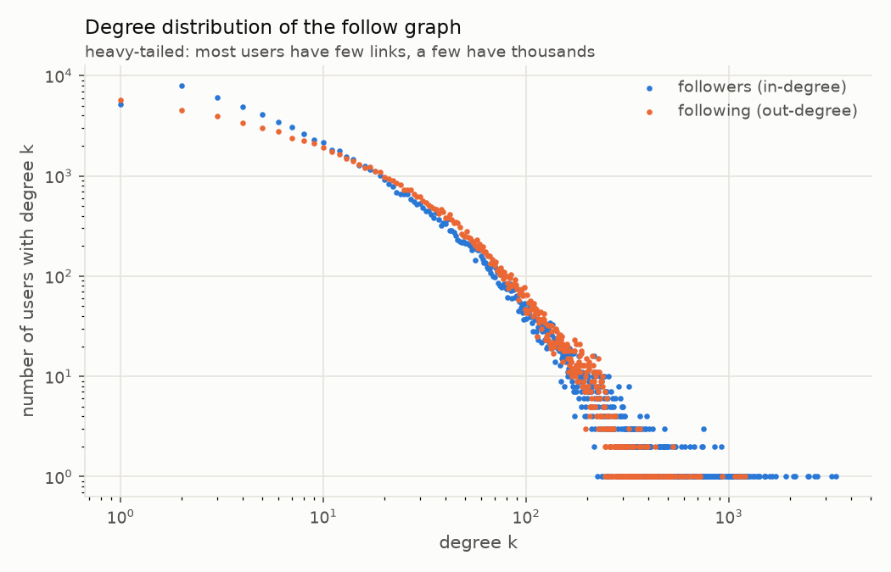
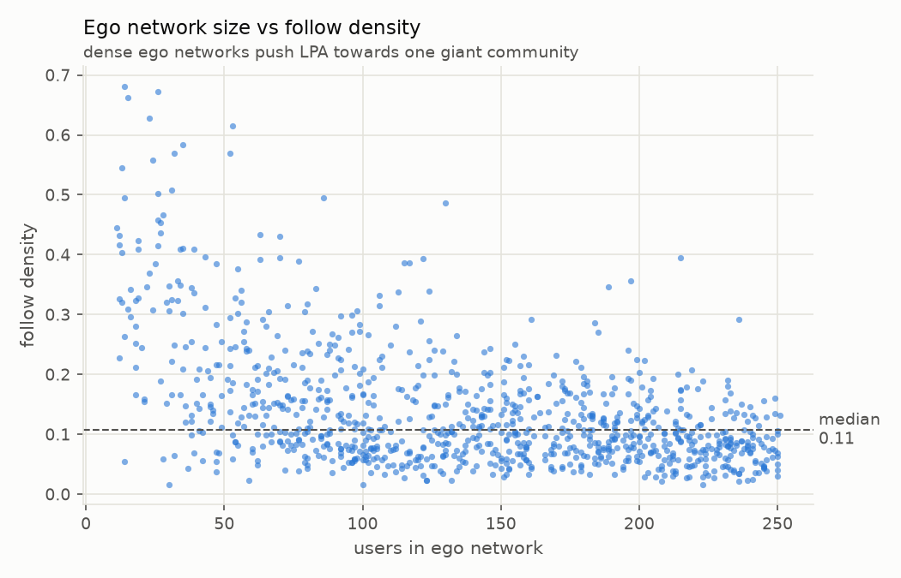
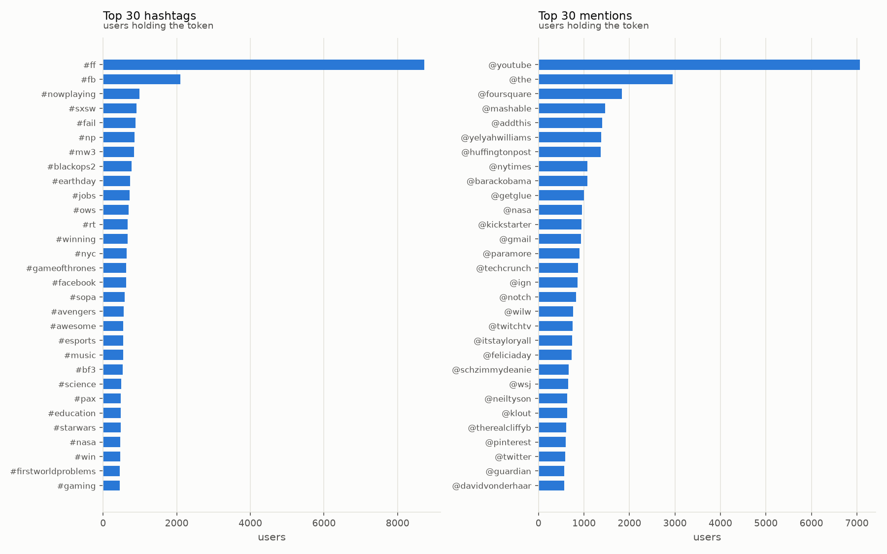
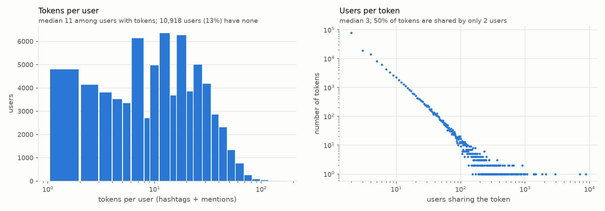
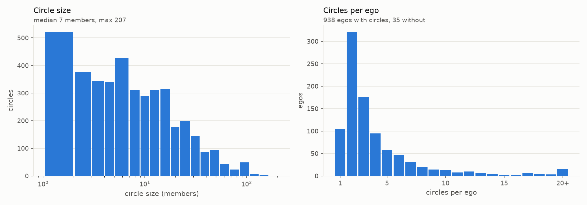

# EDA Report: SNAP ego-Twitter

**Project:** Community Detection Among Social Media Users Based on Common Interests Using the Label Propagation Algorithm
**Dataset:** SNAP ego-Twitter (McAuley & Leskovec, NIPS 2012)
**Notebook:** [`notebooks/01_eda.ipynb`](../notebooks/01_eda.ipynb) · **Numbers:** [`outputs/eda_stats.json`](../outputs/eda_stats.json) · **Code:** [`pipeline/eda.py`](../pipeline/eda.py)

---

## Summary

The dataset has **81,306 Twitter users** in **973 ego networks**, linked by **1.76 million follow edges**.
Users are described by **155,454 interest tokens** (24,032 hashtags and 131,422 mentions).

Five findings shape how community detection should be run and judged:

1. **Ego networks are dense.** A median of 11% of all possible follow pairs exist. On plain follow edges,
   this pushes LPA to merge most users into one giant community.
2. **About half of all follows are mutual (48%).** Keeping only mutual follows removes the weaker,
   one-way ties and breaks up the giant community.
3. **Interest data is sparse.** 13% of users have no tokens, and a token is typically shared by only 3 users.
   Interest similarity alone cannot place every user, which is why the hybrid graph mode exists.
4. **Raw tokens were noisy.** About 30% of distinct tokens carried stray punctuation from tweet text
   (`@mashable:`). Cleaning merged 61,363 duplicate spellings.
5. **Circles are partial, overlapping ground truth.** They cover only 27% of each ego network,
   and 18% of members are in more than one circle. Circle F1 can never reach 1.0 and favours large communities.

---

## 1. Dataset at a glance

| Item | Count |
|---|---|
| Users | 81,306 |
| Follow edges (unique, directed) | 1,762,504 |
| Ego networks | 973 (35 without circles) |
| Users with no follow edges | 5,037 |
| Circles (ground truth) | 4,065 |
| Distinct interest tokens | 155,454 (24,032 hashtags + 131,422 mentions) |
| (user, token) pairs | 1,084,064 |

An **ego network** is the set of accounts one user (the *ego*) follows, plus the follow links among them.
The ego is assumed to follow every user in its network.

---

## 2. Cleaning the interest tokens

Each ego network lists its own features (`#hashtag` or `@mention`) in a `.featnames` file.
The same token appears under different indices in different egos, so tokens are merged by their text.
Three cleaning steps run in `pipeline/preprocess.py → normalize_token`:

| Step | Distinct tokens | Removed | Example |
|---|---|---|---|
| Raw feature names | 216,817 | — | `#Python`, `@mashable:` |
| Lowercase | 198,458 | 18,359 | `#Python` → `#python` |
| Cut to word characters, drop junk | **155,454** | 43,004 | `@mashable:` → `@mashable`; `#1`, `#...` dropped |

The punctuation step matters most. Retweets begin with *"RT @user: …"*, so before cleaning,
about 30% of tokens ended in a stray `:`, `.`, `,` or `!`. The same account then counted as two
unrelated interests. After the fix, the interest graph places 61% of users in a community,
up from 55% before.

SNAP had already removed tokens used by a single user: every token is shared by at least 2 users.
The `--min-token-users 2` option therefore changes nothing on this dataset.

---

## 3. The follow graph



| Measure | Value |
|---|---|
| Median followers (in-degree) | 9 (max 3,383) |
| Median following (out-degree) | 10 (max 1,205) |
| Reciprocity (share of follows that are mutual) | **48.3%** |

Both degree distributions are **heavy-tailed**: most users have a few links, and a few accounts have thousands.
That is typical of social networks. Because 48% of follows are mutual, `--direction mutual` keeps about half of
the edges, the stronger two-way ties.

---

## 4. Ego network size and density



Ego networks have **11 to 251 users** (median 141). **Follow density** is the share of possible
directed follow pairs that actually exist. Its median is **0.11**, and small egos reach 0.68.

**Why it matters:** LPA spreads each label to neighbours, and in a dense graph every label quickly reaches everyone.
In step 5, follow mode with `--direction any` put **82%** of users into one community (hybrid mode: 80%).
Keeping only mutual follows lowers this to 43–47%.

---

## 5. Interests: hashtags and mentions



The most common tokens are **Twitter habits, not interests**: `#ff` (Follow Friday), `#fb`, `#rt`,
`#nowplaying`, `@youtube`, `@the`. TF-IDF gives them little weight because so many users share them.
Below them are clear topic groups:

| Topic | Example tokens |
|---|---|
| Gaming | `#mw3`, `#blackops2`, `#bf3`, `#esports`, `#gaming`, `@ign`, `@twitchtv`, `@notch` |
| Tech news | `@mashable`, `@techcrunch`, `@kickstarter`, `@pinterest` |
| News and politics | `@nytimes`, `@huffingtonpost`, `@wsj`, `@guardian`, `@barackobama`, `#ows`, `#sopa` |
| Science | `#science`, `#nasa`, `#earthday`, `@nasa`, `@neiltyson` |
| Entertainment | `#gameofthrones`, `#avengers`, `#starwars`, `@paramore` |



| Measure | Value |
|---|---|
| Users with ≥1 hashtag | 64.2% |
| Users with ≥1 mention | 83.2% |
| Users with no tokens | **13.4%** (10,918 users) |
| Median tokens per user (users with tokens) | 11 |
| Median users per token | 3 |

**Why it matters:** mentions are far more common than hashtags, so the interest graph uses both (`--tokens both`).
Because tokens are sparse, many users have no neighbour above the similarity threshold (`--min-sim 0.2`).
The interest-only graph leaves 39% of users without a community. The **hybrid** mode fixes this
by adding follow edges.

---

## 6. Ground-truth circles



| Measure | Value |
|---|---|
| Ego networks with circles | 938 of 973 |
| Circles | 4,065 |
| Circle size | median 7, max 207 |
| Single-member circles | 520 |
| Circle members in >1 circle (mean per ego) | **18.1%** |
| Share of each ego covered by circles (mean) | **27.5%** |

Circles are lists that users made themselves. They are not complete community labels:

- **Partial:** circles cover only about 27% of each ego network. Circle F1 is computed only on users who are in a circle.
- **Overlapping:** 18% of members are in several circles, but LPA gives each user exactly one community,
  so a perfect F1 is impossible.
- **Biased towards big groups:** putting every user into a single community scores F1 = 0.689 on the top 20 egos.
  This **one-community baseline** is higher than every algorithm. Report circle F1 alongside it and alongside `largest_share`.

---

## 7. Implications for the experiments

| Finding | Effect on LPA | Response in this project |
|---|---|---|
| Dense ego networks (median density 0.11) | Labels flood the graph and form one giant community | Report `largest_share`; use `--direction mutual` |
| 48% of follows are mutual | Mutual edges keep the stronger ties | `--direction mutual` |
| 13% of users have no tokens; tokens are sparse | The interest graph leaves 39% of users alone | Hybrid mode adds follow edges |
| Generic tokens dominate | They would link unrelated users | TF-IDF down-weights common tokens |
| Punctuation split tokens | One interest counted as two | `normalize_token` cuts tokens to word characters |
| Circles are partial and overlapping | F1 ceiling below 1, favours big communities | Score circle members only; compare with the one-community baseline |

**Effect on the step 5 results** (top 20 egos, our LPA, best of 10 runs):

| Setting | Circle F1 | Interest purity | Communities | Largest community |
|---|---|---|---|---|
| One-community baseline | 0.689 | — | 1 | 100% |
| Follow, all follows | 0.672 | 0.29 | 2.5 | 82% |
| Interest only | 0.420 | **0.84** | 32.7 | 11% |
| Hybrid, all follows | 0.677 | 0.30 | 3.0 | 80% |
| **Hybrid, mutual follows** | 0.570 | 0.47 | 14.5 | 47% |

The EDA explains these results. With all follows, the dense follow edges swamp the interest signal.
With mutual follows only, hybrid LPA finds about 15 communities that are both socially connected and
noticeably more interest-coherent (purity 0.47 vs 0.30).

---

## Reproduce

```bash
source venv/bin/activate
python -m pipeline.download
python -m pipeline.preprocess
python -m pipeline.eda                     # numbers + figures only
jupyter notebook notebooks/01_eda.ipynb    # same analysis, with explanations
```
